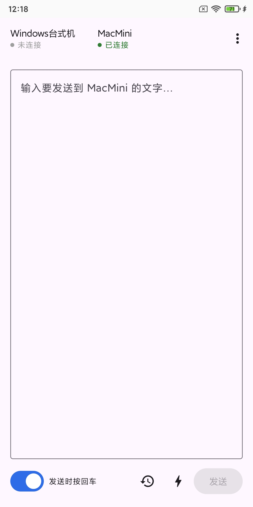
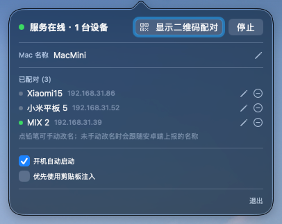
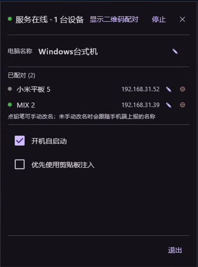

# 投字 / TypeBridge —— 局域网键入桥

> **版本：v2.1**
> 用安卓手机把文字"投"到电脑当前光标处。安卓端作为 **WebSocket 客户端**，通过**扫码**完成一次配对；电脑端作为 **WebSocket 服务端**，接收加密文本并注入键盘。全链路 **AES-256-GCM** 加密，**PSK 为唯一信任根**。

---

## 组件

| 组件 | 平台 | 角色 | 技术栈 | 文档 |
|---|---|---|---|---|
| 客户端 | Android | WebSocket 客户端（扫码、加密、发送） | Kotlin + Jetpack Compose + Room | [client-android/readme.md](client-android/readme.md) |
| 服务端 | macOS | WebSocket 服务端（二维码、键盘注入） | Swift + SwiftUI + FlyingFox | [server-macos/readme.md](server-macos/readme.md) |
| 服务端 | Windows | WebSocket 服务端（二维码、键盘注入） | Kotlin + Compose Desktop | [server-windows/readme.md](server-windows/readme.md) |

> 安卓端可同时配对多台电脑（Mac / Windows），靠 `hello_ack.serverId` 区分；协议与加密三端完全对齐（`typebridge://connect` + v2 帧协议）。

---

## 应用截图

### Android 客户端



### macOS 服务端



### Windows 服务端



---

## 快速构建与验证

### Android

```bash
cd client-android
./gradlew :app:assembleDebug          # APK: app/build/outputs/apk/debug/app-debug.apk
./gradlew :app:testDebugUnitTest      # 8 个加密单测
```

> 需要 Android SDK 36；Gradle 9 需要 JDK 17+ 运行，源码/字节码目标为 Java 11。

### macOS

```bash
cd server-macos
swift test                            # 13 个测试
./Scripts/build-app.sh                # 产物: dist/投字.app
```

> ad-hoc 签名；重新构建后可能需要重新勾选辅助功能、重新开启开机启动。

### Windows

```bash
cd server-windows
./gradlew build                       # 构建 + 单测（14 个加密/协议/集成用例）
./gradlew :app:run                    # 本地运行（托盘 + 主面板 + 配对窗口）
./gradlew :app:createDistributable    # 绿色包输出到 app/dist
./gradlew :app:packageMsi             # MSI 安装包输出到 app/dist
./gradlew :app:packageExe             # EXE 安装包输出到 app/dist
```

> 已实现与 macOS 对等的核心功能（加密/会话/WS 服务端/键盘注入/二维码/设备管理/开机自启），并完成 `.exe` / `.msi` 打包配置；mDNS 未实现，二维码只带 IP。详见 [server-windows/readme.md](server-windows/readme.md)。

---

## 三端共享的契约不变式

任何一端的实现都不能破坏这 6 条：

1. **PSK 是唯一信任根**，从二维码来，不从连接来。
2. **`deviceId` 是纯元数据**，不参与认证。
3. **未认证的 `hello` 不允许探测设备是否存在**（先 PSK 认证、后查设备）。
4. **`sensitive` 固定文本永不下发**，只在电脑端（Mac / Windows）执行时本地读取。
5. **`NeedRescan` 是唯一兜底**：任何时候连不上 / 认证失败 / 指纹不符 / 被移除，都收敛到"请重新扫码"。
6. **移除设备 = 断开连接 + 撤销会话**：必须重新扫码才能再次配对。

---

## 目录结构

```
type-bridge/
├── client-android/          # 安卓客户端（Kotlin + Compose + Room）
│   └── readme.md
├── server-macos/            # macOS 服务端（Swift + SwiftUI + FlyingFox）
│   └── readme.md
├── server-windows/          # Windows 服务端（Kotlin + Compose Desktop）
│   ├── core/                # 纯 JVM 核心库（加密/会话/WS/注入/存储）
│   ├── app/                 # Compose Desktop 壳（托盘 + 主面板 + 配对窗口）
│   └── readme.md            # 设计文档
├── assets/                  # 图标源文件
├── LICENSE                  # 开源协议
├── android.jpg              # README 截图（Android）
├── macos.png                # README 截图（macOS）
├── windows.png              # README 截图（Windows）
└── readme.md                # 本文件（总览）
```
